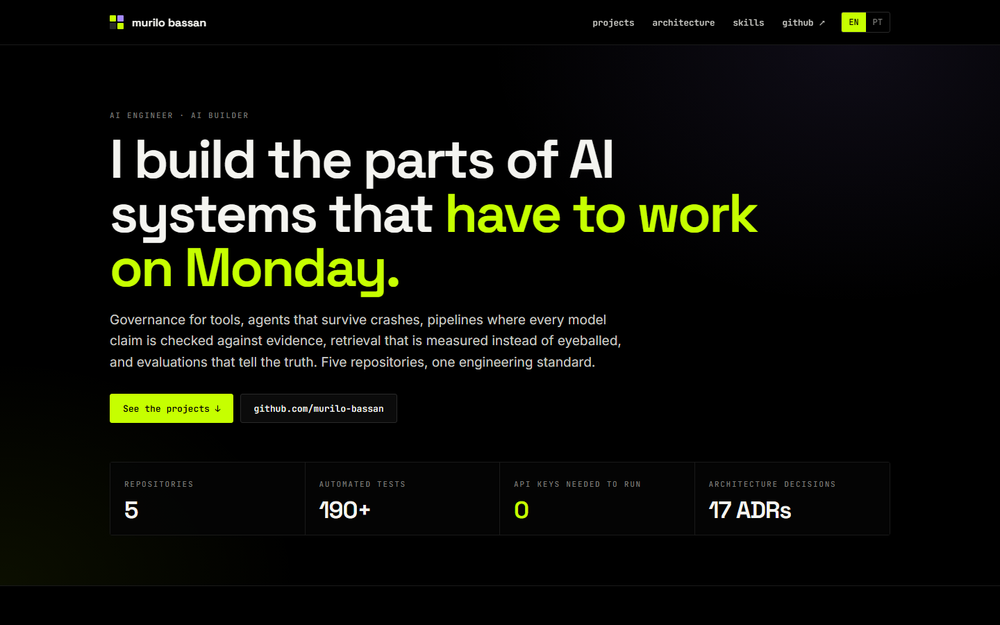
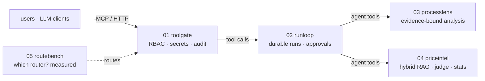

# Murilo Bassan — AI Engineering

**I build the parts of AI systems that have to work on Monday.**

Five repositories, one engineering standard: governed tools, durable agents, evidence-bound
pipelines, measured retrieval and honest evaluation. **Model-agnostic**: any
OpenAI-compatible provider plugs in through the environment, and a deterministic reference engine behind the same interface keeps tests and CI exact.

**English** · [Português](README.pt-BR.md)

---

## Projects

| # | Project | The production question it answers | Proof |
|---|---|---|---|
| 01 | **[toolgate](https://github.com/murilo-bassan/mcp-tool-gateway)** · `mcp-tool-gateway` | Who may call which tool, with which data — and can you prove it? | MCP server with per-tool RBAC, Fernet secrets, four-eyes dynamic tools, SSRF guards, hash-chained audit, chat with stored conversations · 102 tests |
| 02 | **[runloop](https://github.com/murilo-bassan/durable-agent-runtime)** · `durable-agent-runtime` | What happens when the worker dies mid-run, the user clicks twice, the budget runs out? | Postgres `SKIP LOCKED` queue, resumable transcripts, exactly-once effects, token reservations, argument-bound approvals · chaos drill: **24/24 runs after SIGKILL, 0 duplicates** |
| 03 | **[processlens](https://github.com/murilo-bassan/process-automation-agents)** · `process-automation-agents` | What should we automate in this process — and where does it say so? | LangGraph over BPMN + docs; every claim verified against evidence; rubric scoring; structured output with self-repair; DOCX reports · 34 tests |
| 04 | **[priceintel](https://github.com/murilo-bassan/hybrid-rag-price-intel)** · `hybrid-rag-price-intel` | How much did the public sector actually pay for this? | BM25 + pgvector + RRF, LLM judge with adaptive depth, unit normalization, robust stats, Next.js 15 · **worst-case error 968% → 14%**, CI quality gate |
| 05 | **[routebench](https://github.com/murilo-bassan/llm-routing-eval-lab)** · `llm-routing-eval-lab` | Which router sends a request to the right tool — and is an LLM worth it? | Template-level split, OOS false-accepts, macro-F1, bootstrap CIs, exact McNemar, ECE, cascades · LLM numbers measured, never typed |

## How they fit

## Skills, with proof

| skill | 01 | 02 | 03 | 04 | 05 |
|---|:-:|:-:|:-:|:-:|:-:|
| MCP servers & tool design | ● | | | | ● |
| Agent loops, tool calling, human-in-the-loop | | ● | ● | | |
| Multi-agent orchestration (LangGraph) | | | ● | | |
| RAG: BM25, embeddings, pgvector, RRF | | | | ● | |
| LLM-as-judge, structured output, self-repair | | | ● | ● | ● |
| Hallucination containment / grounding | | | ● | ● | |
| Evaluation: IR metrics, calibration, significance | | | | ● | ● |
| Cost control: budgets, cascades, caching | | ● | ● | | ● |
| Security: RBAC, secrets, SSRF, CSRF, PII masking | ● | ● | ● | | |
| Reliability: queues, idempotency, exactly-once effects | | ● | | | |
| Postgres, SQL, migrations | ● | ● | | ● | |
| FastAPI, SSE, Next.js / TypeScript | ● | ● | ● | ● | |
| Docker, CI quality gates, ADRs | ● | ● | ● | ● | ● |

## Principles
1. **Models propose, code decides** — evidence checks, scores and permissions are deterministic.
2. **Measure, don't eyeball** — ground truth, ablations, confidence intervals, CI gates; unflattering results stay in.
3. **Design for the crash** — at-least-once with idempotent effects, ownership checks on every write.
4. **One door, one trail** — every call through one executor, every action in a tamper-evident log.
5. **Reproducible by default** — synthetic data from fixed seeds and a deterministic reference engine behind every model call, so CI results are exact.
6. **Decisions are written down** — 17 ADRs across the repos, including what was left out and why.

Every repository has a README in English and in Portuguese, and every UI switches between EN and PT-BR.

---

Site: static HTML/CSS in the shared **VOID** visual language (true black, hairlines, lime + violet). MIT licensed.
