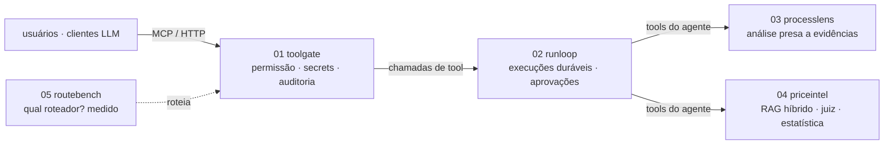

# Murilo Bassan — Engenharia de IA

**Eu construo a parte dos sistemas de IA que precisa funcionar na segunda-feira.**

Cinco repositórios, um mesmo padrão de engenharia: tools governadas, agentes duráveis, pipelines
presos a evidências, busca medida e avaliação honesta. Tudo roda offline, **sem nenhuma chave de
API**, com substitutos determinísticos dos modelos; qualquer endpoint compatível com OpenAI entra pelo ambiente.

[English](README.md) · **Português**

---

## Projetos

| # | Projeto | A pergunta de produção que responde | Prova |
|---|---|---|---|
| 01 | **[toolgate](https://github.com/murilo-bassan/mcp-tool-gateway)** · `mcp-tool-gateway` | Quem pode chamar qual tool, com quais dados, e dá para provar? | Servidor MCP com permissão por tool, secrets Fernet, tools dinâmicas com revisão a quatro olhos, proteção contra SSRF, auditoria encadeada por hash e chat com conversas salvas · 102 testes |
| 02 | **[runloop](https://github.com/murilo-bassan/durable-agent-runtime)** · `durable-agent-runtime` | O que acontece quando o worker morre no meio, o usuário clica duas vezes, o orçamento acaba? | Fila no Postgres com `SKIP LOCKED`, transcripts retomáveis, efeitos exatamente uma vez, reserva de tokens, aprovações presas aos argumentos · teste de caos: **24/24 execuções depois de SIGKILL, 0 duplicadas** |
| 03 | **[processlens](https://github.com/murilo-bassan/process-automation-agents)** · `process-automation-agents` | O que automatizar neste processo, e onde está escrito isso? | LangGraph sobre BPMN + documentos; toda afirmação checada contra evidência; nota por rubrica; saída estruturada com autocorreção; relatórios DOCX · 34 testes |
| 04 | **[priceintel](https://github.com/murilo-bassan/hybrid-rag-price-intel)** · `hybrid-rag-price-intel` | Quanto o setor público pagou de verdade por isto? | BM25 + pgvector + RRF, juiz com LLM e profundidade adaptativa, normalização de unidades, estatística robusta, Next.js 15 · **pior erro de 968% → 14%**, portão de qualidade no CI |
| 05 | **[routebench](https://github.com/murilo-bassan/llm-routing-eval-lab)** · `llm-routing-eval-lab` | Qual roteador manda o pedido para a tool certa, e o LLM vale o preço? | Split por template, falso aceite fora de escopo, macro-F1, IC por bootstrap, McNemar exato, ECE, cascatas · números de LLM medidos, nunca digitados |

## Como se encaixam

## Habilidades, com prova

| habilidade | 01 | 02 | 03 | 04 | 05 |
|---|:-:|:-:|:-:|:-:|:-:|
| Servidores MCP e design de tools | ● | | | | ● |
| Loops de agente, tool calling, humano no circuito | | ● | ● | | |
| Orquestração multiagente (LangGraph) | | | ● | | |
| RAG: BM25, embeddings, pgvector, RRF | | | | ● | |
| LLM como juiz, saída estruturada, autocorreção | | | ● | ● | ● |
| Contenção de alucinação / fundamentação | | | ● | ● | |
| Avaliação: métricas de IR, calibração, significância | | | | ● | ● |
| Controle de custo: orçamentos, cascatas, cache | | ● | ● | | ● |
| Segurança: permissões, secrets, SSRF, CSRF, mascaramento de dados pessoais | ● | ● | ● | | |
| Confiabilidade: filas, idempotência, efeitos exatamente uma vez | | ● | | | |
| Postgres, SQL, migrations | ● | ● | | ● | |
| FastAPI, SSE, Next.js / TypeScript | ● | ● | ● | ● | |
| Docker, portões de qualidade no CI, ADRs | ● | ● | ● | ● | ● |

## Princípios
1. **O modelo propõe, o código decide**: checagem de evidências, notas e permissões são determinísticas.
2. **Medir, não olhar no olho**: gabarito, ablações, intervalos de confiança, portões no CI; resultados desfavoráveis ficam.
3. **Projetar para a queda**: pelo menos uma vez com efeitos idempotentes, checagem de dono em toda escrita.
4. **Uma porta, uma trilha**: toda chamada passa por um executor só, toda ação vai para um log à prova de adulteração.
5. **Reproduzível por padrão**: dados sintéticos com sementes fixas, substitutos offline, nenhuma chave para rodar.
6. **Decisões ficam escritas**: 17 ADRs nos repositórios, inclusive o que ficou de fora e por quê.

Todos os repositórios têm README em inglês e em português, e as interfaces têm opção PT-BR/EN.
O site deste repositório (`index.html`) é publicado via GitHub Pages e também tem as duas versões.

---

Site: HTML/CSS estático na linguagem visual **VOID** compartilhada (preto absoluto, linhas finas, verde-limão + violeta). Licença MIT.
